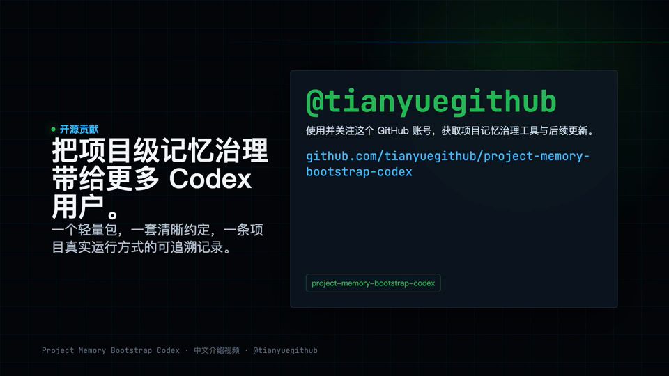
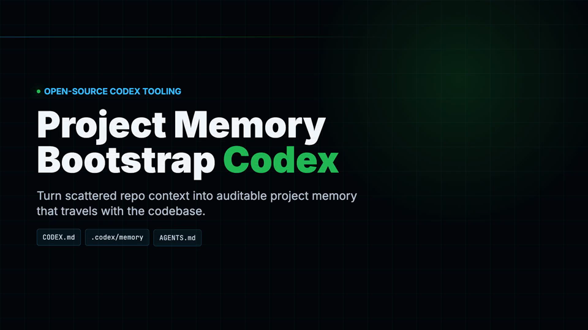

# Project Memory Bootstrap Codex

面向本机多开发工具的项目共享记忆程序。项目指令由AGENTS.md拥有，项目地图由README.md拥有，受管知识由可读Markdown拥有；持久账本保存候选、提交与抑制决定，SQLite检索索引只是可重建投影。它不替代或改写工具的原生记忆。

当前开发版本为 `0.2.0.dev0`，协议版本1。已实现共享CLI、项目/工作区解析、事实级读取、候选/提案/单文件发布与恢复；宿主自动接入、持续任务和业务内容恢复的结果必须单独验证，不能由程序测试推导。

已登记项目也可通过本机 stdio MCP 使用同一记忆。Codex 普通沙箱可能保护 `.codex` 路径；此时使用范围受限的 MCP 工具，不关闭沙箱或直接绕过账本读取旧正文。

可选 MCP 入口需要 Python 3.10+ 与 `pip install 'project-memory-bootstrap-codex[mcp]'`（当前验证 SDK 1.26.0）；启动命令为 `python -I -m project_memory_bootstrap_codex.mcp_server`。它只代理已登记项目的既有协议，不执行任意 shell，不自动初始化项目，不另建知识库。使用固定解释器路径安装宿主配置，避免工作区 Python 切换影响入口。CLI 基础功能不依赖 MCP SDK。

## 协议与入口

[共享记忆协议](src/project_memory_bootstrap_codex/resources/shared-memory-protocol.md)是唯一字段和行为合同，CLI直接读取同一资源，不要求每个目标项目复制文档。

```bash
project-memory-bootstrap-codex protocol --brief
project-memory-bootstrap-codex protocol
project-memory-bootstrap-codex --version
```

## 安装与初始化

```bash
pip install -e .
project-memory-bootstrap-codex init /path/to/project
project-memory-bootstrap-codex doctor /path/to/project
```

初始化只创建缺失的README、AGENTS和 `.codex/memory/MEMORY.md`，保留已有文件；不创建CODEX或自动补写日记。显式 `--today YYYY-MM-DD` 可记录初始化事件。初始化不等于启用自动维护或核验业务事实。

## 登记共享项目

```bash
project-memory-bootstrap-codex register-project /path/to/project --id my-project --member api=api --enable-maintenance
project-memory-bootstrap-codex project-context /path/to/project/api
project-memory-bootstrap-codex register-alias /path/to/project /path/to/checkout --repository api
```

成员身份必须精确登记；普通Git worktree可由common-dir验证，复制型工作区使用显式别名。不按目录名称或远端URL猜测归属。共享状态缺失时拒绝用旧正文或缓存冒充正常，不自动创建空账本掩盖丢失。

本机根定位默认在 `~/.config/project-memory-bootstrap/projects.json`。隔离测试可用 `PROJECT_MEMORY_REGISTRY` 指定其他位置，无须改HOME或CODEX_HOME。

## 按需读取

```bash
project-memory-bootstrap-codex search-memory /path/to/project "关键词"
project-memory-bootstrap-codex get-memory /path/to/project F-example --json
project-memory-bootstrap-codex context-memory /path/to/project --id F-example --max-tokens 800
project-memory-bootstrap-codex memory-health /path/to/project
```

受管项目默认返回有效事实及明确标注的待复核/冲突项；`--history`可查看退休状态，但不能读取forgotten正文。过长事实返回展开入口，正文与适用条件不被截断。当前预算参数使用4字符/单位的近似，输出明确说明它不是模型分词器测量值。

索引、状态、search/get/context共享读取范围。未登记旧项目默认读取README、AGENTS和顶层记忆，显式 `--include-legacy` 才读取旧CODEX/CLAUDE/CURSOR等载体；受管项目不允许通过legacy模式绕过生命周期。读前会检查缓存新鲜度，必要时重建。

## 带证据写入

```bash
project-memory-bootstrap-codex capture-memory /path/to/project --input candidate.json
project-memory-bootstrap-codex pending-memory /path/to/project
project-memory-bootstrap-codex candidate-memory /path/to/project CANDIDATE_ID
project-memory-bootstrap-codex propose-memory /path/to/project --input proposal.json
project-memory-bootstrap-codex commit-memory /path/to/project PROPOSAL_ID
project-memory-bootstrap-codex recover-memory /path/to/project
```

JSON也可经stdin传入，不把正文或凭证放入argv。字段见唯一协议。任务代理负责实际证据核验，合并器负责项目/来源/事实版本、抑制、串行提交和恢复；字段齐全不证明语义真实。多次转述不是多个独立来源。

程序在锁内读取最新正文并应用事实操作，一次只发布一个MEMORY.md文件。真实进程中断后依据prepared日志恢复；没有新知识的判断只形成处理回执，不应改写正文。锁只约束受管写者，不能保证任意外部编辑器参与竞争仍不丢更新；外部改动会明确报告，不能盲目覆盖。

## 生命周期与恢复

- 规范要求、实现观察、验证结果和用户决定分别标注；OpenSpec归档与任务勾选不代表部署或验收完成。
- 更正、替代、撤回和遗忘通过提案提交，读取和恢复都检查抑制状态。事实范围的遗忘不自动扩大为删除其整个来源。
- 候选接收、语义处理、发布和索引更新分别记录；额度失败不能推进处理完成位置。
- 本机状态与缓存均不得进入Git；原始证据保留原owner，秘密不得写入知识库。
- 原始聊天/宿主记忆/备份/Git历史的物理删除是另外的范围，不由删除共享正文隐含完成。

## 旧整理命令

`consolidate-memory` 及报告命令仅供未登记旧项目的显式检查/整理；受管项目拒绝该入口。旧确定性清理不承担语义融合，也不接入本轮自动恢复链。不得因文件年龄自动推断事实无效。

## 开发与验证

```bash
PYTHONPATH=src python3 -m unittest discover -s tests
PYTHONPATH=src python3 -m project_memory_bootstrap_codex.cli doctor .
```

发布协调目前使用POSIX文件锁。单元、真实子进程和CLI测试与宿主GUI/CLI验收分开报告。公开发布只包含通用程序、模板和合成夹具，不包含用户项目的私人记忆、工作区映射或处理状态。

## 早期版本演示

以下视频展示早期版本，当前接口以本页和随包协议为准。

### 中文版（带配音）

[](https://cdn.jsdelivr.net/gh/tianyuegithub/project-memory-bootstrap-codex@3b418625943a8278e64280649e1317b37a671307/docs/videos/project-memory-bootstrap-codex-intro-zh.mp4)

点击封面即可播放 [中文版 MP4](https://cdn.jsdelivr.net/gh/tianyuegithub/project-memory-bootstrap-codex@3b418625943a8278e64280649e1317b37a671307/docs/videos/project-memory-bootstrap-codex-intro-zh.mp4)，视频文件保存在本仓库。

### English with voiceover

[](https://cdn.jsdelivr.net/gh/tianyuegithub/project-memory-bootstrap-codex@3b418625943a8278e64280649e1317b37a671307/docs/videos/project-memory-bootstrap-codex-intro-en.mp4)

Click the cover to play the [English MP4](https://cdn.jsdelivr.net/gh/tianyuegithub/project-memory-bootstrap-codex@3b418625943a8278e64280649e1317b37a671307/docs/videos/project-memory-bootstrap-codex-intro-en.mp4). The video file is stored in this repository.
